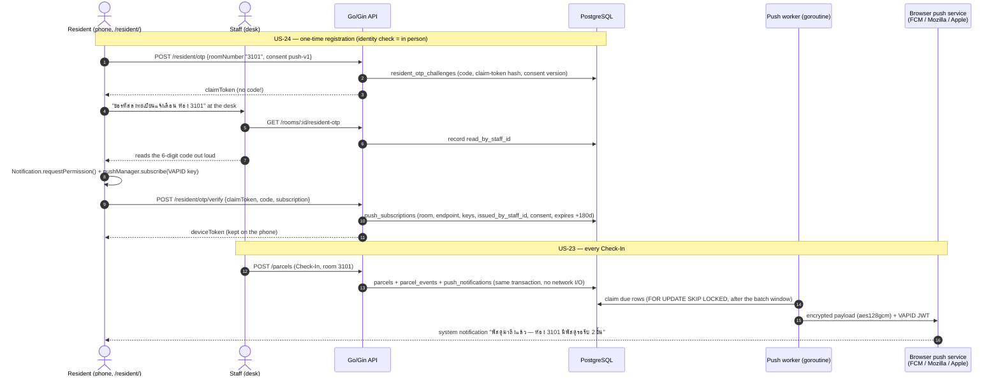

# Design — Resident Notifications via PWA / Web Push

> Version: 1.0 | Created: 2026-10-21 | Status: **Implemented, pending advisor sign-off (scope change)**
> Backlog: Epic E3 revision — `US-23`, `US-24`, `US-25` (supersede `US-08`, `US-11`) · Legal: `LR-01`, `LR-03`, `LR-04`, `LR-05` · Ethics: `ET-04`
> Code: `db/migrations/0005_web_push_notifications.sql` · `backend/internal/{push,notify}/` · `backend/internal/store/push.go` · `backend/internal/api/push_handlers.go` · `docs/02-design/prototype/{resident/, src/resident/, public/resident/}`

---

## 1. Why

The team is no longer using LINE for Resident communication. The old design (Epic E3, 2026-09-22) was
**pull only**: a Resident linked their LINE account and tapped "Check Parcel" to ask. That leaves the
Resident's real problem in place — they still have to remember to ask.

The replacement is a **push notification to the Resident's phone the moment Staff Check-In a Parcel
for their room**, delivered through the browser's standard Web Push — no LINE, no SMS, no native app,
no per-message cost. The Resident installs nothing from a store: they open a web page (a PWA), register
once, and the phone shows a system notification when something arrives.

**Scope note.** `CLAUDE.md` puts anything beyond Check-In / Check-Out / Search / Dashboard /
Directory / audit trail behind advisor review. This is a *replacement* of an existing Resident-facing
epic (E3), not a new channel on top of it, and it adds no framework or library (Go stdlib crypto,
browser-native APIs). It still changes Resident-facing behaviour from pull to push, so it is flagged
for advisor sign-off in the backlog and the 2026-10-21 log.

## 2. Choices considered

| Option | Cost | Reach | Why / why not |
|---|---|---|---|
| **PWA + Web Push** ✅ | Free | Android Chrome/Edge/Firefox/Samsung; desktop browsers; iPhone/iPad **iOS 16.4+ once added to Home Screen** | Real phone notification, no app store, no third-party account, standard protocol (RFC 8030/8291/8292) |
| University e-mail | Free | Everyone has `@lamduan.mfu.ac.th` | Many students rarely open it; not "instant" |
| SMS | Per message | Everyone | ~400–1,000 Parcels/day ⇒ real money every day |
| LINE OA | Push quota / paid tier | Most students | Dropped by the team |
| Lobby display screen | Hardware | Only people walking past | Not a notification |

## 3. How it works

### 3.1 Registration (US-24) — the desk OTP

The identity check is **the same in-person hand-off that already existed for LINE**: the code is only
ever shown to a signed-in Staff member, who reads it to the Resident at the desk. The Resident's phone
receives a *claim token*, never the code.

- Code: 6 digits, valid 5 minutes, single use, 5 wrong tries burn it (`OTP_EXPIRED` with `reason: locked`).
- A correct code that **no Staff member has looked up yet** counts as wrong — matching it could only be a guess.
- Max 3 open requests per room at a time (`TOO_MANY_OTP_REQUESTS`), so nobody can flood the desk's list.
- Room claim is matched **exactly** against the directory (`3101` = building 3, room 101). A bare
  `101` that exists in several buildings is rejected as `AMBIGUOUS_ROOM` — same rule as the LINE flow
  and the "never trust a free-text room" constraint.
- The claim token and the device token are 256-bit random values; only their SHA-256 is stored.

### 3.2 Delivery (US-23) — transactional outbox + worker

- **Check-In never waits for the network.** It only inserts `push_notifications` rows inside its own
  transaction (one per active device of that room). A push-service outage therefore cannot slow down or
  fail a Check-In (`ET-04`). Assign-Room on an unmatched Parcel queues the same way — that is the moment
  its Resident becomes known.
- **Batching:** Parcels for the same room within `PUSH_BATCH_WINDOW_SECONDS` (default 60 s) merge into
  the one still-unclaimed row (`ON CONFLICT … DO UPDATE parcel_ids = parcel_ids || …`). A courier dropping
  five Parcels for one room is one notification, not five. During a Flash Sale this is what keeps
  ~1,024 Parcels/day to a few hundred messages.
- **Already picked up?** At send time the worker recounts. If every Parcel in the batch is no longer
  Pending, the row is `cancelled` and nothing is sent.
- **Worker:** a goroutine in the API process, polling every 10 s. Rows are leased with
  `FOR UPDATE SKIP LOCKED` + a 2-minute lease, so two API instances never double-send and a crash just
  delays a row.
- **Push-service answers:** 2xx → `sent`; 404/410 → the subscription is gone (uninstalled, permission
  revoked) → it is unsubscribed (`gone`) and never retried; 429/5xx/network → retry with backoff
  30 s → 1 m → 2 m → 4 m, `failed` after 5 attempts; other 4xx → `failed`.
- `Topic: room-<id>` header: if the phone is offline, a newer message for the room replaces the older
  one at the push service instead of queuing up. `TTL` 24 h.

### 3.3 Crypto (no new dependency)

`backend/internal/push` implements Web Push with the Go standard library only:

- **RFC 8291** payload encryption (ECDH P-256 → HKDF-SHA-256 → AES-128-GCM, `aes128gcm` content coding).
  Verified against the RFC's own Appendix A test vector in `push_test.go`.
- **RFC 8292 VAPID**: ES256 JWT (`aud` = push-service origin, `exp` 12 h, `sub` = `VAPID_SUBJECT`).
- **SSRF guard**: the backend POSTs to whatever endpoint a browser hands it, so endpoints are accepted
  only on `https` + the known push services (`fcm.googleapis.com`, `*.push.services.mozilla.com`,
  `*.notify.windows.com`, `*.push.apple.com`). Anything else is `VALIDATION_ERROR subscription.endpoint`.

### 3.4 The Resident PWA (US-25)

`/resident/` is a separate Vite entry (own bundle, manifest and service-worker scope), Thai UI,
phone-first. Three screens: **claim** (room + consent) → **verify** (code from the desk; this click
also asks for notification permission, which Safari requires inside a user gesture) → **status**
(this room's Pending Parcels, refresh, turn notifications off). It doubles as the pull view that
`US-08` used to provide.

- The service worker (`public/resident/sw.js`) builds the Thai notification text from machine values
  — the backend never sends user-facing strings (design-spec §5).
- `pushsubscriptionchange` is handled: the worker re-subscribes and `PUT`s the new subscription using
  the device token, which the page leaves in Cache Storage (service workers have no `localStorage`).
  The page also re-sends its current subscription every time it opens.
- iPhone/iPad: Web Push only works for a PWA **added to the Home Screen** (iOS/iPadOS 16.4+). The page
  detects this and shows the three-step "Share → Add to Home Screen" guide instead of the form.

## 4. Data model (migration 0005)

| Table | Purpose | Key columns |
|---|---|---|
| `resident_otp_challenges` | Registration requests | `room_id`, `claim_token_hash`, `code`, `consent_version`, `attempts`, `expires_at`, `consumed_at`, `read_by_staff_id`, `read_at` |
| `push_subscriptions` | One row per registered browser | `room_id`, `endpoint`, `p256dh`, `auth`, `device_token_hash`, `consent_version`, `otp_challenge_id`, `issued_by_staff_id`, `verified_at`, `expires_at`, `last_success_at`, `unsubscribed_at`, `unsubscribed_reason`, `unsubscribed_by_staff_id` |
| `push_notifications` | Delivery outbox | `subscription_id`, `room_id`, `parcel_ids[]`, `status`, `attempts`, `next_attempt_at`, `sent_at`, `last_http_status`, `last_error` |

New enums: `push_notification_status` (`queued`/`sent`/`failed`/`cancelled`),
`push_unsubscribe_reason` (`resident`/`staff`/`gone`/`replaced`). Nothing is hard-deleted.
The 0004 LINE tables stay in place, unused.

## 5. API

| Method & path | Who | Purpose |
|---|---|---|
| `GET /resident/push/config` | anyone | `{vapidPublicKey, consentVersion}` |
| `POST /resident/otp` `{roomNumber, consentVersion, consentAccepted}` | anyone | Claim a room → `{claimToken, expiresAt, roomNumber, buildingCode}` |
| `POST /resident/otp/verify` `{claimToken, code, subscription}` | anyone | Register → `{deviceToken, device}` |
| `GET /resident/me` | device bearer | `{device, pendingCount, pending[]}` (US-10 minimal data) |
| `PUT /resident/push/subscription` | device bearer | Replace a rotated browser subscription |
| `DELETE /resident/push/subscription` | device bearer | Turn notifications off (withdraw consent) |
| `GET /rooms/:roomId/resident-otp` | Staff | The code to read out; records who read it |
| `GET /rooms/:roomId/push-subscriptions` | Staff | `{activeCount}` |
| `DELETE /rooms/:roomId/push-subscriptions` | Staff | Revoke every device of a room (move-out) → `{revokedCount}` |

New error codes: `PUSH_NOT_CONFIGURED` 503 · `NO_PENDING_RESIDENT_OTP` 404 · `OTP_INVALID` 422
(`attemptsLeft`) · `OTP_EXPIRED` 410 (`reason: locked` after 5 wrong tries) · `TOO_MANY_OTP_REQUESTS` 429.

Resident routes authenticate with `Authorization: Bearer <deviceToken>`, never a cookie, so they
need no CSRF handling and can't be triggered by a cross-site form.

## 6. Privacy & compliance

| Rule | How it's met |
|---|---|
| **LR-01** consent before storing | Consent text (`src/resident/consent.js`, version `push-v1`) must be ticked before a code is issued; the server refuses a claim without it |
| **LR-03** minimisation | No name, phone or student ID is collected — a registration is tied to a *room*. The push payload holds only room number and counts; no Tracking Codes, no names. Push services relay it encrypted and can't read it |
| **LR-05** verifiable consent record | Each registration stores the consent version, the challenge it came from, the Staff member who read the code (`issued_by_staff_id`), and timestamps — never just `agreed = true` |
| **LR-04** action log | Registration, Staff code look-ups, revocations and every delivery attempt are stored with actor/time; nothing is deleted |
| Withdrawal | "ปิดการแจ้งเตือน" in the PWA, or Staff revoke at the desk; registrations also **expire after 180 days** so a Resident who moved out stops getting that room's notifications |
| **ET-04** degrade gracefully | Push is optional (no VAPID keys ⇒ feature off, Check-In unaffected) and fully decoupled via the outbox |

## 7. Deployment

1. Generate keys once: `docker compose run --rm backend /app/vapidkeys` → put `VAPID_PUBLIC_KEY`,
   `VAPID_PRIVATE_KEY`, `VAPID_SUBJECT` in `docker/.env`. Rotating keys forces everyone to re-register.
2. **HTTPS is required** for service workers and push (except `localhost`). For phone testing in dev,
   use a tunnel (e.g. `cloudflared tunnel --url http://localhost:5173`) and open `https://…/resident/`.
3. The front end must serve `/resident/` (Vite dev/preview already do; a production static host just
   serves `dist/resident/index.html`).
4. Put a QR code linking to `https://<host>/resident/` at the parcel desk.

## 8. Tests

- `backend/internal/push/push_test.go` — RFC 8291 test vector, VAPID signature verification, key
  parsing, endpoint allow-list, subscription validation.
- `backend/internal/api/push_test.go` — integration (real PostgreSQL + a fake push service that
  decrypts each message): full register → Check-In → notify → status flow, batching, cancelled when
  already picked up, OTP must be read by Staff, lockout, rate limit, gone subscription, retry/backoff,
  unsubscribe, Staff revoke, re-registering the same browser, rotated subscription, SSRF allow-list,
  feature-off behaviour.
- `src/resident/ResidentApp.test.jsx`, `src/components/ResidentOtpModal.test.jsx` — UI flows with MSW.
- Manual end-to-end (2026-10-21): real backend + Vite + Chromium; service-worker push delivered via
  DevTools rendered "พัสดุมาถึงแล้ว / ห้อง 3101 มีพัสดุใหม่ 2 ชิ้น (รอรับทั้งหมด 3 ชิ้น)…".

## 9. Open items

- Advisor sign-off on the E3 change (pull → push).
- Real-device check on an iPhone (Home Screen PWA) and an Android phone over HTTPS.
- Optional later: a reminder for Parcels Pending longer than N days (would reuse the same outbox).
- The LINE code path (`internal/line`, `/line/webhook`, `LineOtpModal.jsx`) is no longer wired into
  the UI; remove it in a follow-up once the advisor confirms.
